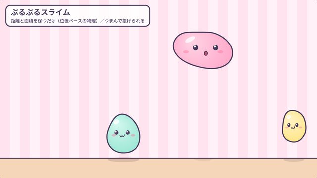

# 生き物と自然の動き — ブラウザだけで動くデモ集

魚が泳ぐ、トカゲが歩く、スライムがぷるぷるする、炎がゆらぐ。
こうした「生きている感じ」の動きを、**ライブラリなしの HTML と JavaScript だけ**で作ったデモ集です。
1本ずつが小さな HTML なので、ブラウザで開けばそのまま動き、コードもそのまま読めます。



## デモ

| # | デモ | 中身 | 操作 |
|---|---|---|---|
| 01 | [泳ぐ魚](demos/01-fish/) | 背骨の鎖（間隔と曲がる角度の上限）に、体の幅の表をかぶせる | クリックでエサ |
| 02 | [トカゲとクモ](demos/02-lizard-spider/) | 足が離れすぎたら1歩。ひざは2関節の逆運動学（IK） | マウスにトカゲが寄ってくる |
| 03 | [群れ（Boids）](demos/03-boids/) | 分離・整列・結合の3つのルール＋タカから逃げる | マウスがタカ |
| 04 | [ぷるぷるスライム](demos/04-slime/) | 位置ベースの物理（PBD）で、距離と面積を保つ | つまんで投げる |
| 05 | [クラゲ](demos/05-jellyfish/) | かさは「速く縮んでゆっくり戻る」。触手はヴェルレ積分のひも | — |
| 06 | [マントと髪の揺れ](demos/06-cape-hair/) | 同じ動きの2人を、揺れものなし／ありで比べる | — |
| 07 | [アニメ調の炎](demos/07-fire/) | 格子の流体（Stable Fluids）＋浮力。同じ炎を2通りに塗る | — |
| 08 | [水面とアヒル](demos/08-water/) | 高さ場の水。アヒルが沈んだ分だけ水を押しのける | クリックでアヒル |
| 09 | [絵の具の渦](demos/09-paint-smoke/) | 07 と同じ流体に色を流す。渦の強調でくるくる巻く | ドラッグでかき混ぜ |
| 10 | [模様が育つ](demos/10-patterns/) | 反応拡散（Gray-Scott）。F と k だけで模様が変わる | クリックでたね |
| 11 | [ぽよん](demos/11-squash/) | 同じ跳び方を「そのまま／つぶれと伸び／＋ため・余韻」で比べる | — |

一覧ページは [index.html](index.html)。GitHub Pages を有効にすると、そのまま公開できます。

## 動かし方

- いちばん簡単なのは、`index.html` をブラウザで開くことです（ファイルを直接開いても動きます）。
- ローカルサーバーで開く場合：`python -m http.server` を実行し、`http://localhost:8000` を開きます。

## 動画に書き出す

`tools/capture.py` でデモを1コマずつ撮って、MP4 にできます。
ページを `?capture` 付きで開くと、時間が実時間ではなく「コマ」単位で進みます。重いデモでも、カクつかずに書き出せます。

```bash
pip install playwright && playwright install chromium   # 最初の1回だけ
python tools/capture.py demos/04-slime --seconds 10 --out slime.mp4
python tools/capture.py demos/07-fire --stills 2,4,6 --out shots/   # 静止画
```

`?seed=2` のように seed を変えると、別の動きになります（同じ seed なら毎回同じ動き）。

## つくり

```
common/motion.js   画面・固定の時間刻み・seed 付き乱数・書き出し用のフック
common/chain.js    背骨の鎖（01・02）
common/ik.js       2関節の逆運動学と「踏み出す」ルール（02）
common/fluid.js    格子の流体ソルバー（07・09）
demos/NN-*/        デモ本体（index.html と main.js）
tools/capture.py   動画・静止画の書き出し
```

- 時間の刻みは 1/60 秒で固定しています。物理の安定のため、デモによっては1コマを細かく分けて計算しています（substeps）。
- 見た目はわざとパステルで、太い線の「ステッカー風」にそろえています。

## 参考（考え方の出典）

コードはすべてこのリポジトリ用に書き直したもので、下の資料のコードを写したものではありません。

- 01・02 背骨の鎖：argonaut「A simple procedural animation technique」（動画）と [argonautcode/animal-proc-anim](https://github.com/argonautcode/animal-proc-anim)（MIT）
- 02 手続き型の歩き：Rain World の GDC 2016 講演（Joar Jakobsson, James Therrien）
- 03 Boids：Craig Reynolds, *Flocks, Herds, and Schools: A Distributed Behavioral Model*（SIGGRAPH 1987）
- 04・06 位置ベースの物理：Matthias Müller ほか *Position Based Dynamics*（2007）、[Ten Minute Physics](https://matthias-research.github.io/pages/tenMinutePhysics/index.html)
- 05・06 ヴェルレ積分のひも：Thomas Jakobsen, *Advanced Character Physics*（GDC 2001）
- 07・09 流体：Jos Stam, *Stable Fluids*（SIGGRAPH 1999）。渦の強調：Fedkiw, Stam, Jensen, *Visual Simulation of Smoke*（2001）
- 08 高さ場の水：Ten Minute Physics #20 の考え方
- 10 反応拡散：A. M. Turing（1952）、P. Gray & S. K. Scott（1984）、Karl Sims の解説
- 11 つぶれと伸び：Thomas & Johnston *The Illusion of Life*（アニメーションの12原則）、Martin Jonasson & Petri Purho「Juice it or lose it」（2012）

## ライセンス

MIT（[LICENSE](LICENSE)）
